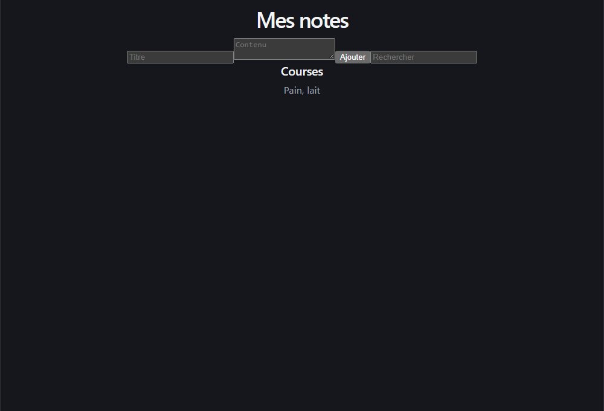
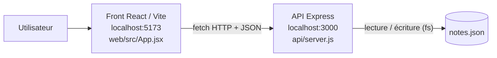

# notes-app

Petite application de prise de notes : une API REST en **Node.js / Express** qui stocke les notes dans un fichier JSON, et un front en **React (Vite)** pour les créer, les lister et les rechercher.

## Prérequis

- [Node.js](https://nodejs.org/) **20.19+ ou 22.12+** (exigé par Vite 8)
- npm (fourni avec Node.js)
- Git
- `curl` pour tester l'API (sous Windows PowerShell, utilisez `curl.exe` ou Git Bash)

## Installation

```bash
git clone https://github.com/Shakil60/notes-app-React.git
cd notes-app-React
```

L'API et le front se lancent séparément, dans **deux terminaux**.

### API (port 3000)

```bash
cd api
npm install
npm start
```

L'API écoute sur **http://localhost:3000** (message `API sur http://localhost:3000`).

### Front (port 5173)

```bash
cd web
npm install
npm run dev
```

Le front est servi par Vite sur **http://localhost:5173**. L'API doit être lancée en même temps.

Autres scripts du front : `npm run build` (build de production dans `web/dist/`), `npm run preview` (sert le build), `npm run lint` (ESLint).

## Configuration

Il n'y a pas de fichier de configuration ni de variable d'environnement :

| Élément | Valeur | Où la changer |
|---|---|---|
| Port de l'API | `3000` | `api/server.js` (`app.listen`) |
| URL de l'API utilisée par le front | `http://localhost:3000` | `web/src/App.jsx` |
| Port du front | `5173` (défaut Vite) | `web/vite.config.js` |
| Fichier de données | `notes.json`, créé dans le dossier où l'API est lancée | `api/server.js` (`FILE`) |

> Lancez l'API **depuis le dossier `api/`** pour que `notes.json` y soit créé. Ce fichier est ignoré par Git.

## Usage

### Format d'une note

```json
{ "id": 1, "title": "Courses", "body": "Lait, pain", "tag": "perso" }
```

L'`id` est attribué par l'API (plus grand id existant + 1).

### Créer une note : `POST /notes`

```bash
curl -X POST http://localhost:3000/notes \
  -H "Content-Type: application/json" \
  -d '{"title":"Courses","body":"Lait, pain","tag":"perso"}'
```

Réponse `201 Created` :

```json
{"id":1,"title":"Courses","body":"Lait, pain","tag":"perso"}
```

### Lister les notes : `GET /notes?page=<n>`

Les notes sont paginées par 10. Avec la version actuelle, `page=0` est traité comme `page=1`.

```bash
curl "http://localhost:3000/notes?page=0"
```

Réponse `200 OK` :

```json
[]
```

> Avec `page=0` ou sans paramètre `page`, l'API utilise `page=1` et renvoie donc les notes 11 à 20 (`[]` s'il y en a moins de 11). Voir [Limites connues](#limites-connues).

### Filtrer par tag : `GET /notes/by-tag/:tag`

```bash
curl http://localhost:3000/notes/by-tag/perso
```

Réponse `200 OK` :

```json
[{"id":1,"title":"Courses","body":"Lait, pain","tag":"perso"}]
```

### Rechercher dans les titres : `GET /search?q=<texte>`

Recherche insensible à la casse, sur le titre uniquement. Le paramètre `q` est obligatoire.

```bash
curl "http://localhost:3000/search?q=cour"
```

Réponse `200 OK` :

```json
[{"id":1,"title":"Courses","body":"Lait, pain","tag":"perso"}]
```

### Supprimer une note : `DELETE /notes/:id`

```bash
curl -i -X DELETE http://localhost:3000/notes/1
```

Réponse `204 No Content` (sans corps), que l'id existe ou non.

### Front



L'écran « Mes notes » permet d'ajouter une note (titre + contenu) et de filtrer les notes affichées par titre.

## Architecture

Les choix de stockage et de pagination sont expliqués dans les [décisions d’architecture](docs/adr/).



```
notes-app/
├── api/            API Express
│   ├── server.js   routes et stockage
│   └── package.json
├── web/            front React (Vite)
│   ├── src/App.jsx écran principal
│   └── package.json
└── .github/        templates d'issue et de PR
```

## Limites connues

- `GET /notes` sans `page` renvoie la 2ᵉ page, donc le front n'affiche rien tant qu'il y a moins de 11 notes.
- `GET /search` sans `q` renvoie une erreur 500.
- Le front n'envoie pas de `tag` à la création et ne permet pas de supprimer une note.
- Pas de validation des champs côté API.

## Contribuer

Pour proposer une modification, voir le [guide de contribution](CONTRIBUTING.md). La page [Qui fait quoi](docs/equipe.md) indique qui contacter selon le dossier.

1. Ouvrez une issue avec le template adapté (`.github/ISSUE_TEMPLATE/`).
2. Créez une branche depuis `main` nommée `<type>/<n°-issue>-<sujet>` (ex. `fix/3-identifiants-notes`, `docs/8-readme`).
3. Faites des commits courts au format `type(portée): message` (ex. `fix(web): …`).
4. Ouvrez une PR en suivant le template, avec `Closes #<n°>` dans la description.
5. La PR est mergée après la review et l'approbation d'un coéquipier.

## Licence

Distribué sous licence MIT. Voir [LICENSE](LICENSE).
